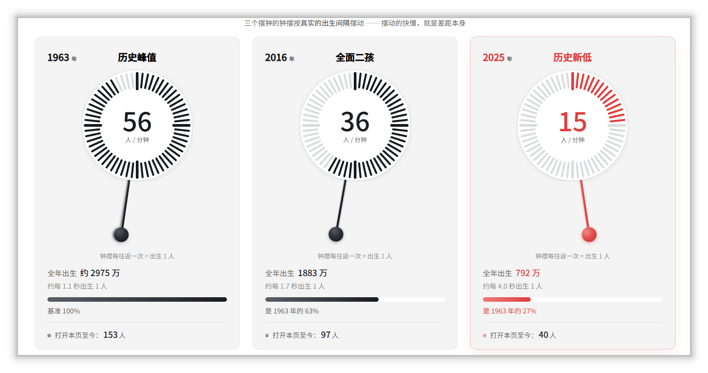

# 人口档案馆（Demography Archive）

**网站：[https://demoarchive.net](https://demoarchive.net)**

## 寂静的产房

当社会还在争论当下的内卷与房价时，未来已在产房的寂静中悄然启程。

三个摆钟的钟摆按真实的出生间隔摆动 —— 摆动的快慢，就是差距本身。

> 全年出生数据来自「国家统计局官网“国家数据”」；“打开本页至今”为平均值估算，不代表真实数据，图中数字为截图时的示例。

产房的寂静，不会停留在产房。人口缩减沿着年龄阶梯逐级向上传导：先是奶粉、托育与幼儿园，然后是小学、中学、大学，再往后是就业、结婚、买房与养老。所有不具备海外市场的行业，规模减半只是时间问题，而且不需要等到下一代人。

「人口档案馆」用数据、地图与可视化记录这条下行曲线：既呈现全国与各省的出生人口、生育率和未来预测，也整理关于人口的常见争论、各方观点与思想实验。本网站不评判任何个体的生育选择，也无意为任何人做出选择。本网站只是想针对“人口与未来”的关系，提出一些新观点（准确来说，是整理一些已有的旧观点），供大家讨论。

## 网站内容

| # | 栏目 | 内容 |
| --- | --- | --- |
| 1 | [正在来临的危险](https://demoarchive.net/harms/) | 人口缩减沿年龄阶梯向上传导：2016 年出生 1883 万，2025 年只剩 792 万；幼儿园、中学、高等教育、日常消费品、公务员与事业编、房地产、互联网依次承压，电力和医院可能是例外。 |
| 2 | [各省生育地图](https://demoarchive.net/map/) | 2016\~2025 年各省出生人口降幅排序，以及分省出生人口与出生率地图（各省起始年份不一）；点击省份查看历年数据。 |
| 3 | [未来人口预测](https://demoarchive.net/forecast/) | 队列要素法推演 2026\~2100 年人口；高、中、低三情景总和生育率为 1.3、1.0、0.8，可查看总人口、出生、死亡与年减少人数。 |
| 4 | [各国生育率与生育支持](https://demoarchive.net/world/) | 1960\~2024 年世界各国（总和）生育率地图；2010\~2023 年 OECD 国家家庭福利公共支出占 GDP 比重排名与走势。 |
| 5 | [永恒的争论](https://demoarchive.net/debates/) | 逐条回应六种常见论点：人口过多论、收缩红利论、机器替代论、内卷降低论、少生优生论、补贴无用论。 |
| 6 | [各方观点](https://demoarchive.net/viewpoints/) | 普京、李光耀、马斯克、李显龙、梁建章、黄文政六人关于人口问题的公开表述，共 74 条，按时间倒序并附出处。 |
| 7 | [思想实验](https://demoarchive.net/thought-experiment/) | 三篇叙事型实验：《少子化的囚徒困境》《博士与母亲》《2060年的五百万》，分别讨论个体理性、代际账本与养老兑付。 |
| 8 | [数据中心](https://demoarchive.net/datacenter/) | 全国、各省、预测与国际比较共 8 组数据；在线交互查看，并可下载 xlsx，清单见下一节。 |
| 9 | [其他](https://demoarchive.net/other/) | 人口概念解释：总人口、出生人口、出生率、（总和）生育率、世代更替水平、老龄化与少子化、婴儿潮与回声潮；另含关于本站与联系方式。 |

## 数据下载

全部文件位于仓库 `data/` 目录，也可在[数据中心](https://demoarchive.net/datacenter/)逐项下载。

各组数据的起始年份不同，具体见各行说明及文件内表注。

| # | 数据组 | 文件 | 内容与说明 |
| --- | --- | --- | --- |
| 1 | [全国历年出生人口](https://demoarchive.net/datacenter/#secNat) | `nbs-national-data.xlsx` `yuwa-births-backcast.xlsx` | 全国历年出生人口、出生率、年末总人口；国家统计局与育娲人口智库两套口径并列，便于对照。起始年份与口径见文件内说明。 |
| 2 | [七普回溯出生人口](https://demoarchive.net/datacenter/#secCensus) | `population-census-2020.xlsx` | 依据 2020 年第七次全国人口普查分年龄人口，回溯“当年出生、2020 年仍健在”的人数。 |
| 3 | [各年代年均出生人口](https://demoarchive.net/datacenter/#secDec) | `avg-births-by-decade.xlsx` | 上世纪 50 年代以来各年代出生人口年均值；2025 年为当年出生人口。 |
| 4 | [未来人口预测](https://demoarchive.net/datacenter/#secFc) | `forecast-all.xlsx` `forecast-population.xlsx` `forecast-births.xlsx` `forecast-deaths.xlsx` `forecast-decrease.xlsx` | 2026\~2100 年高、中、低三情景（总和生育率 1.3 / 1.0 / 0.8）；`forecast-all` 为完整数据，其余四份分别为总人口、出生人口、死亡人口、年减少人数，单位万人。 |
| 5 | [各省历年出生数据](https://demoarchive.net/datacenter/#secProv) | `provinces/*.xlsx`（34 份） | 34 个省级行政区各一份；起始年份因省而异，详见各文件表内说明。按地区分组见下表。 |
| 6 | [各省出生人口下降幅度](https://demoarchive.net/datacenter/#secDecline) | `provincial-births-decline-2016-2025.xlsx` | 各省 2016 与 2025 年出生人口及降幅（%）；降幅 =（2025 年 − 2016 年）÷ 2016 年。 |
| 7 | [各国生育率](https://demoarchive.net/datacenter/#secWorld) | `wdi-tfr-by-country.xlsx` | 世界银行 WDI，1960\~2024 年各国（总和）生育率。 |
| 8 | [各国生育补贴支出](https://demoarchive.net/datacenter/#secSupport) | `public-family-spending-by-type-gdp-pct.xlsx` | OECD SOCX，2010\~2023 年各国家庭公共支出（现金及实物）占 GDP 比重。 |

### 省级数据文件

文件均位于 `data/provinces/`；点击省级行政区名称打开对应 xlsx。每份数据表内均附详细数据来源、统计口径与注释。

| 地区 | 省级行政区 |
| --- | --- |
| 华北 | [北京市](data/provinces/beijing.xlsx)、[天津市](data/provinces/tianjin.xlsx)、[河北省](data/provinces/hebei.xlsx)、[山西省](data/provinces/shanxi.xlsx)、[内蒙古自治区](data/provinces/neimenggu.xlsx) |
| 东北 | [辽宁省](data/provinces/liaoning.xlsx)、[吉林省](data/provinces/jilin.xlsx)、[黑龙江省](data/provinces/heilongjiang.xlsx) |
| 华东 | [上海市](data/provinces/shanghai.xlsx)、[江苏省](data/provinces/jiangsu.xlsx)、[浙江省](data/provinces/zhejiang.xlsx)、[安徽省](data/provinces/anhui.xlsx)、[福建省](data/provinces/fujian.xlsx)、[江西省](data/provinces/jiangxi.xlsx)、[山东省](data/provinces/shandong.xlsx)、[台湾省](data/provinces/taiwan.xlsx) |
| 华中 | [河南省](data/provinces/henan.xlsx)、[湖北省](data/provinces/hubei.xlsx)、[湖南省](data/provinces/hunan.xlsx) |
| 华南 | [广东省](data/provinces/guangdong.xlsx)、[广西壮族自治区](data/provinces/guangxi.xlsx)、[海南省](data/provinces/hainan.xlsx)、[香港特别行政区](data/provinces/xianggang.xlsx)、[澳门特别行政区](data/provinces/aomen.xlsx) |
| 西南 | [重庆市](data/provinces/chongqing.xlsx)、[四川省](data/provinces/sichuan.xlsx)、[贵州省](data/provinces/guizhou.xlsx)、[云南省](data/provinces/yunnan.xlsx)、[西藏自治区](data/provinces/xizang.xlsx) |
| 西北 | [陕西省](data/provinces/shaanxi.xlsx)、[甘肃省](data/provinces/gansu.xlsx)、[青海省](data/provinces/qinghai.xlsx)、[宁夏回族自治区](data/provinces/ningxia.xlsx)、[新疆维吾尔自治区](data/provinces/xinjiang.xlsx) |

## 数据来源

- **国家统计局**：全国历年出生人口、出生率、年末总人口；年度人口抽样调查，以及 1982、1990、2000、2010、2020 年历次人口普查。主要取自国家统计局[“国家数据”](https://data.stats.gov.cn/)。
- **各省、自治区、直辖市统计局**：各省历年出生人口、出生率、常住人口，来源为各省统计年鉴、国民经济和社会发展统计公报及省级统计部门公开发布的数据。各省口径、修订情况与缺失年份见对应省份数据表下方注释。
- **马克数据网**：部分统计年鉴文件，用于补充和交叉核对，见 [macrodatas.cn](https://www.macrodatas.cn/)。
- **育娲人口智库**：出生人口回溯数据与研究成果，主要依据[《中国百年历史人口报告》](https://file.c-ctrip.com/files/6/yuwa/0R72e12000ty0rddz037D.pdf)。
- **世界银行 World Development Indicators**：1960\~2024 年各国（总和）生育率，指标代码 `SP.DYN.TFRT.IN`，见 [WDI](https://data.worldbank.org/indicator/SP.DYN.TFRT.IN)。
- **经济合作与发展组织（OECD）**：2010\~2023 年各国家庭公共支出（现金及实物）占 GDP 比重，取自 OECD Social Expenditure Database（SOCX），经 [OECD Data Explorer](https://data-explorer.oecd.org/) 导出。
- **联合国《世界人口展望 2024》**：人口预测所用的中国年龄别生育率与生命表，见 [UN WPP 2024](https://population.un.org/wpp/)。

## 许可

- **代码**：MIT，见 [LICENSE](LICENSE)。
- **文字、图表与页面设计**：© 2026 人口档案馆，未经许可请勿转载。
- **第三方数据**：版权归国家统计局、各省统计局、育娲人口智库、世界银行、OECD、联合国等原始来源所有，使用请遵循各来源条款。
- **第三方库**：ECharts（Apache-2.0）；地图边界数据来自 DataV / 高德，遵循原服务条款。

## 反馈

欢迎通过 [Issues](https://github.com/DemoArchive/demography-archive/issues) 指出数据、文字或代码问题。
